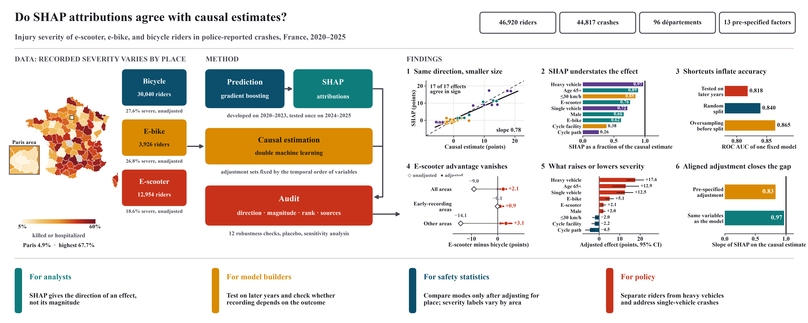
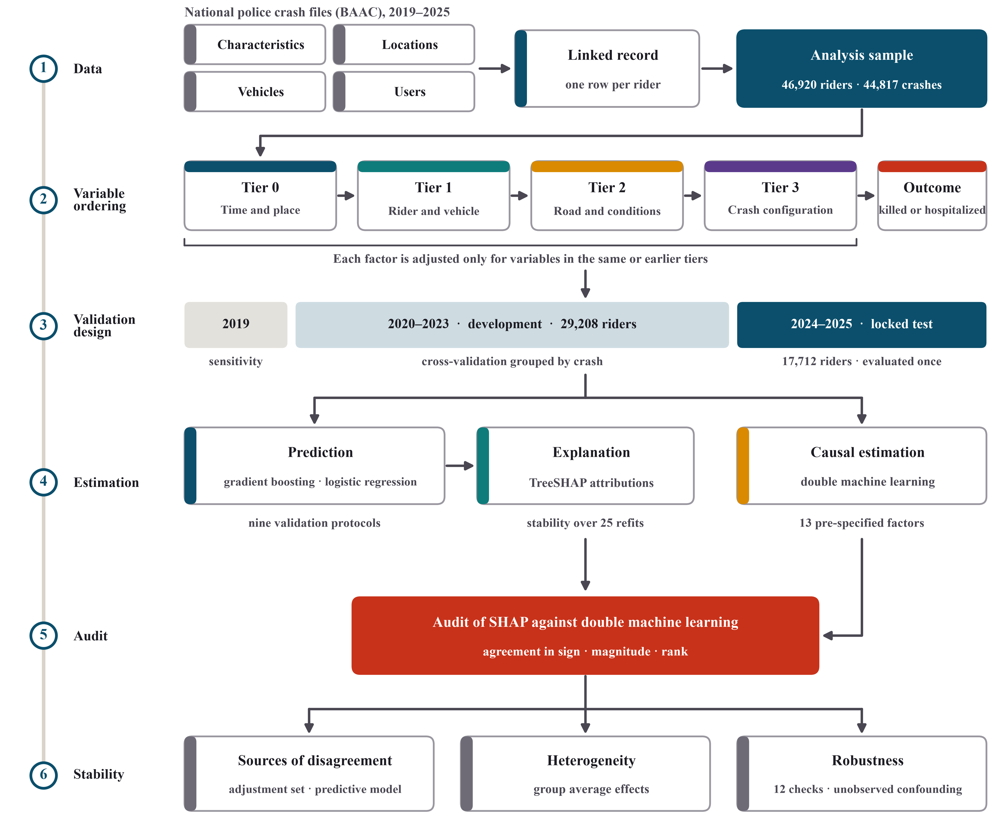

# Do SHAP attributions agree with causal estimates? Micromobility rider injury severity in France

Code, pre-analysis plan and results for the paper:

> Hassan, M. (2026). *Do explainable machine learning attributions agree with causal estimates? Evidence from e-scooter, e-bike, and bicycle rider injury severity in France, 2020–2025.* Manuscript submitted for publication.





## What the study does
The study uses the French national police crash database (BAAC, 2019–2025; 382,721 injury crashes) published as open data by the Observatoire national interministériel de la sécurité routière (ONISR).

- **Sample:** 46,920 riders of bicycles, e-bikes and motorised personal mobility devices (e-scooters) in 44,817 police-reported injury crashes in mainland France, 2020–2025. The outcome is being killed or hospitalised.
- **Prediction:** gradient boosting (LightGBM) and regularised logistic regression, tuned on 2020–2023 by cross-validation grouped by crash and evaluated once on a locked test set (2024–2025). The same model is scored under nine validation protocols to measure how much common shortcuts overstate performance.
- **Explanation:** TreeSHAP attributions, with stability measured over 25 refits.
- **Causal estimation:** doubly robust double machine learning for 13 pre-specified factors, with adjustment sets fixed in advance by the temporal order of the variables.
- **Audit:** for each factor, the SHAP reading is compared with the double machine learning estimate in sign, magnitude and rank, and the difference is decomposed.
- **Checks:** twelve robustness checks, a placebo factor and a sensitivity analysis for unobserved confounding.

| Result | Value |
|---|---|
| Locked-test ROC AUC (95% CI) | 0.818 (0.811 to 0.825) |
| ROC AUC under a random split of riders | 0.840 |
| ROC AUC with oversampling before the split | 0.865 |
| Sign agreement between SHAP and double ML (FDR < 0.05) | 17 of 17 estimates |
| Median SHAP contrast as a fraction of the double ML estimate, all riders | 0.72 |
| Slope of SHAP on double ML: pre-specified adjustment set vs all controls | 0.83 vs 0.97 |
| E-scooter vs bicycle: unadjusted and adjusted difference | −9.0 and +2.1 points (95% CI 0.8 to 3.3) |
| E-bike vs bicycle, adjusted | +5.1 points (3.0 to 7.1) |
| Heavy-vehicle vs car opponent, adjusted | +17.6 points (13.3 to 21.8) |

Effects are differences in the probability of being killed or hospitalised, in percentage points, conditional on a police-reported injury crash.

## Repository layout
```
scripts/
  01_download_baac.py            28 BAAC files, SHA-256 manifest
  02-06_audit_*.py               schema, integrity, coding quirks, values, adoption of vehicle codes
  07_build_clean.py              linked crash, vehicle and user tables
  10_build_analysis_table.py     rider-level analysis table; outcome-dependent recording check
  11_predictive_models.py        tuning, locked test, nine validation protocols
  12_shap.py                     TreeSHAP importance, stability, out-of-fold contrasts
  13_dml_main.py                 double machine learning for 13 factors (all riders and by mode)
  14_audit.py                    SHAP against double ML
  15_robustness.py, 15b_*.py     robustness checks and sensitivity analysis
  16_heterogeneity.py            group average effects
  20_figures.py, 21_tables.py    all figures and tables
  22-24_*.py                     manuscript tables, figure environments and the APA reference list
  p1_common.py, p1_dml.py        shared pipelines, adjustment sets, grouped cross-fitting, clustered inference
docs/
  05_Pre_Analysis_Plan_Paper1.md frozen plan (checksum in DEVIATIONS.md)
  DEVIATIONS.md                  integrity record and all deviations from the plan
  results_summary.md             results in tabular form
  figure_captions.md             captions of Figures 1-10
outputs/results/                 estimates behind every figure and table (CSV, JSON)
outputs/audit/                   data-audit outputs and the download manifest
figures/                         Figures 1-10 (PNG at 600 dpi, PDF)
tables/                          Tables 1-7 and S1-S10 (CSV, LaTeX, Excel)
```

## Reproducing the results
```bash
python3 -m venv .venv && . .venv/bin/activate
pip install -r requirements.txt
PY=python ./run_all.sh
```
The pipeline downloads the data, rebuilds the analysis table and reruns every model. The double machine learning and robustness steps take several hours. Scripts take their input and output folders as arguments and are run with `python -I`.

Rider-level files are not stored here because they are rebuilt from the public source. `data/raw/MANIFEST.csv` lists the 28 source files with their URLs and SHA-256 checksums.

## Safeguards against information leakage
- The test set (2024–2025) was used once, after all tuning.
- Folds are grouped by crash, so riders from the same crash never appear on both sides of a split.
- All preprocessing is fitted inside each training fold.
- Variables whose recording depends on injury severity (safety equipment), and variables derived from the outcome, are excluded from every model.
- Double machine learning uses cross-fitting grouped by crash.

## Data source and licence
- Crash data: Bases de données annuelles des accidents corporels de la circulation routière (BAAC), ONISR, https://www.data.gouv.fr/datasets/53698f4ca3a729239d2036df/ , Licence Ouverte / Open Licence 2.0.
- Code: MIT License (see `LICENSE`).

## Citation
Please cite the paper above. A DOI will be added on publication.
